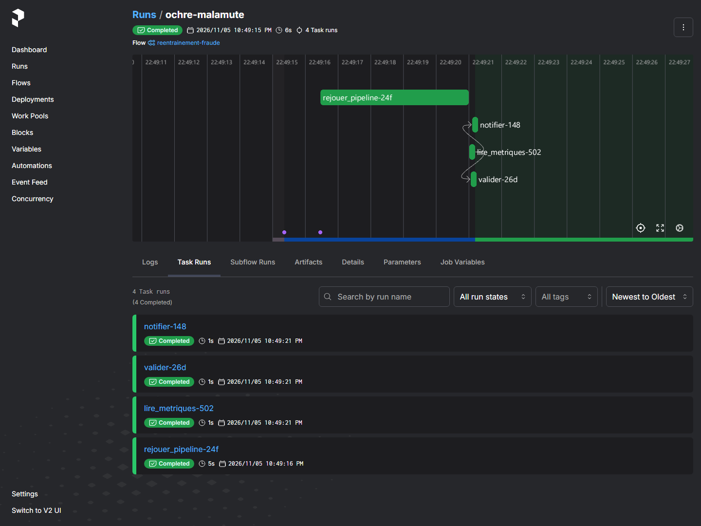
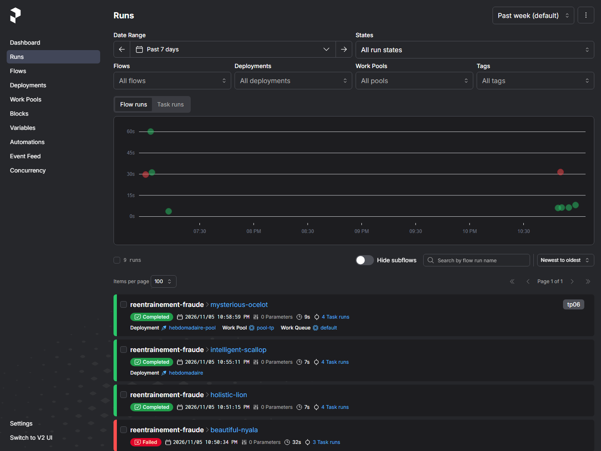
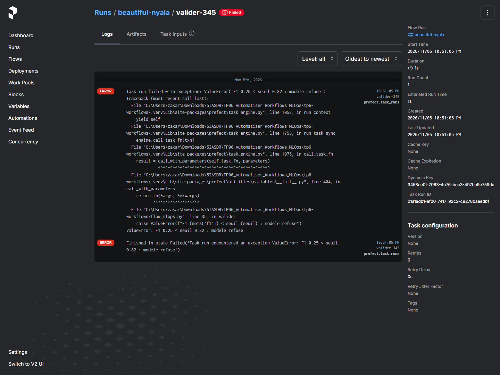
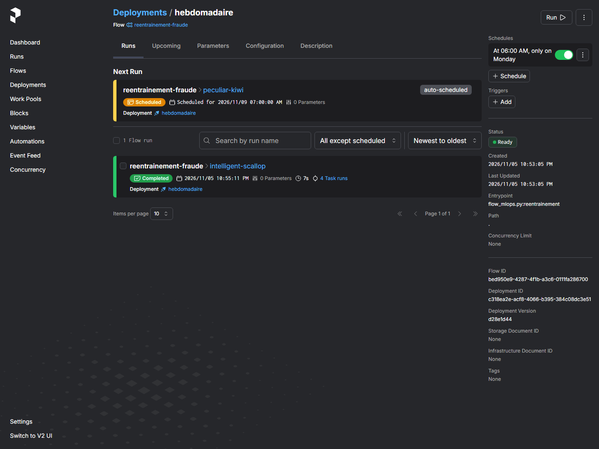
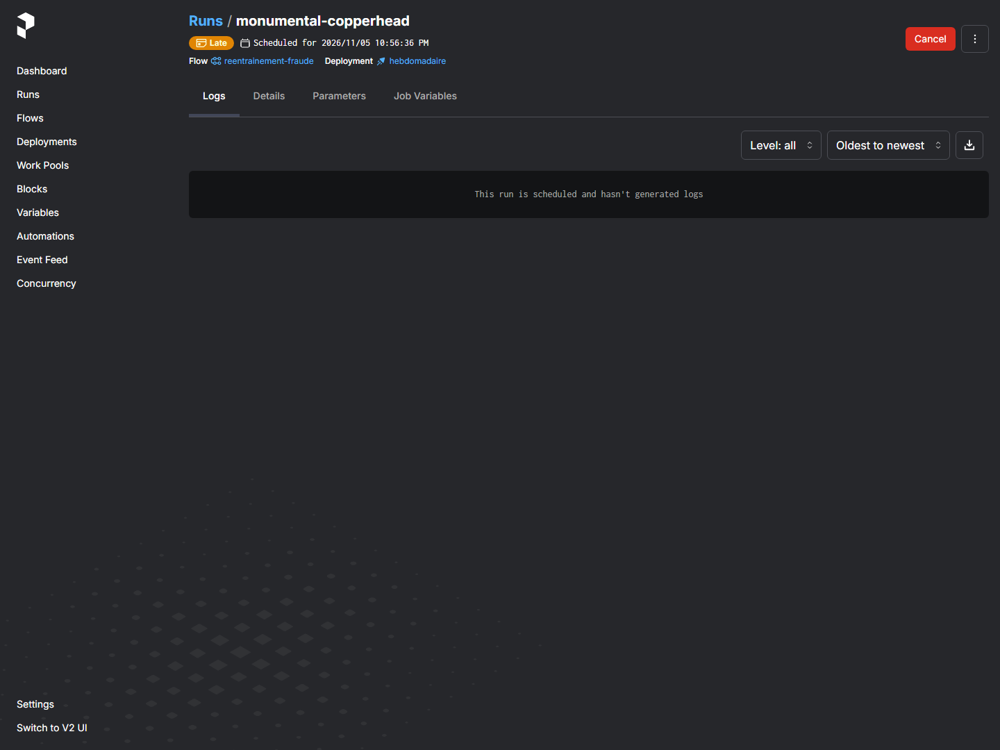
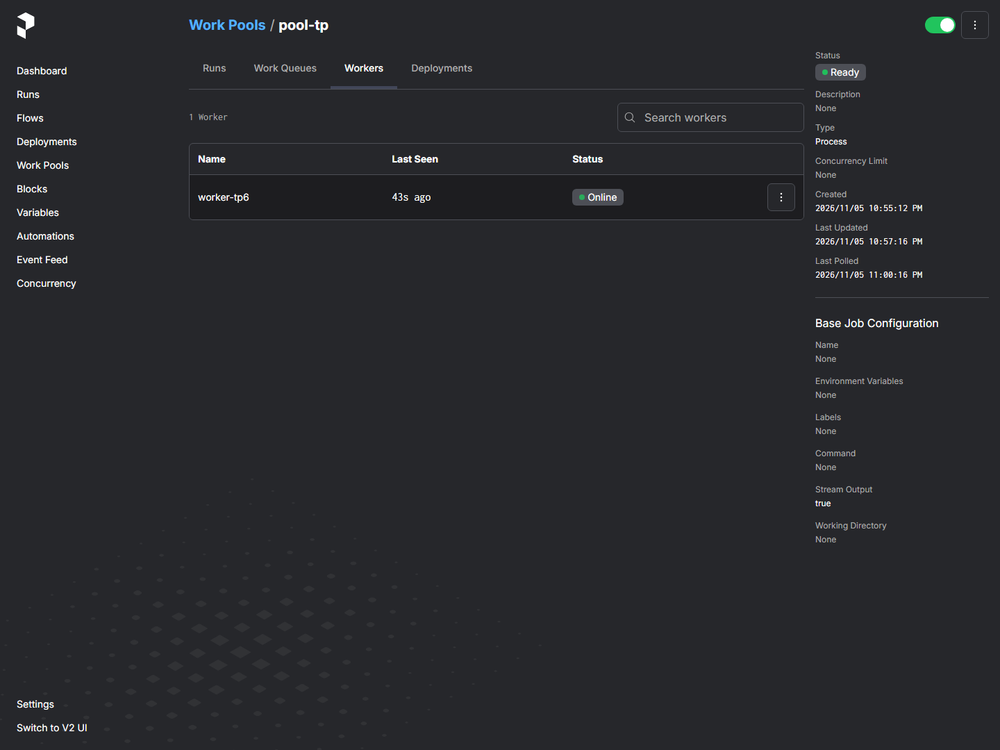
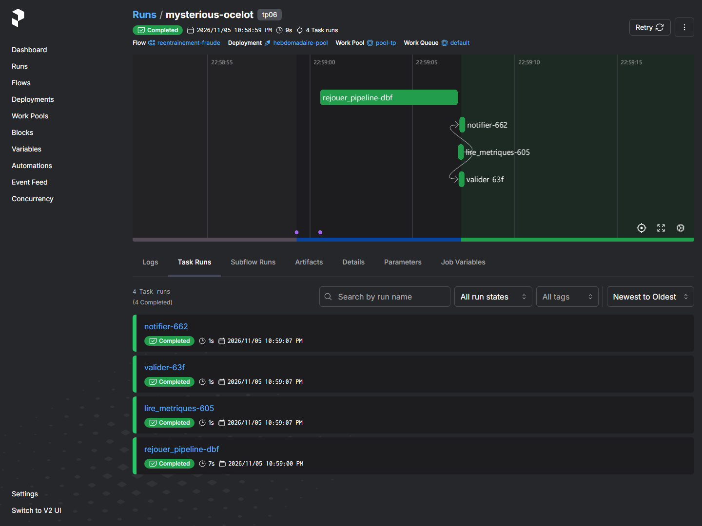
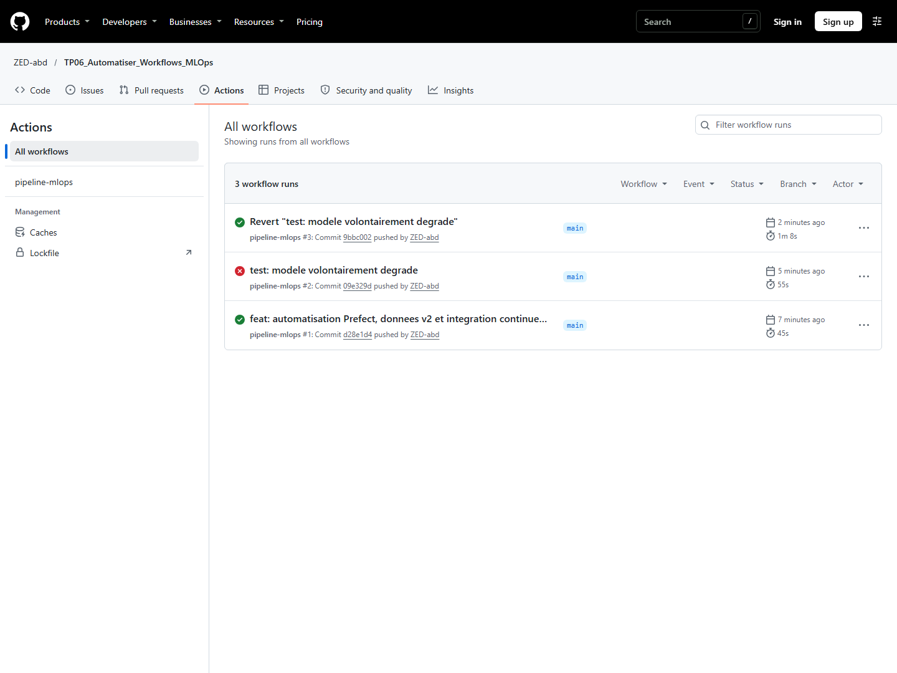
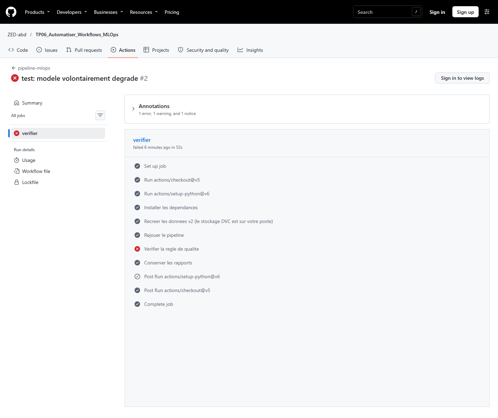

# TP06 — MLOps low-code : automatiser les workflows

**Nom : Abdelbaki — Prénom : Zakaria — Filière : 5IASDR — Groupe : G6**  
**Date : 5 novembre 2026**  
**Dépôt : https://github.com/ZED-abd/TP06_Automatiser_Workflows_MLOps**

## 1. Contexte et environnement

Le projet TP3 a été conservé avec son historique et les tags v1/v2. Le lien distant
du TP3 porte désormais le nom `tp3`, et `origin` pointe vers le dépôt TP6 demandé.
Aucune publication n'a été effectuée vers le dépôt TP3 pendant ce travail.

Environnement testé : Windows, PowerShell, Python 3.12.4, Prefect 3.9.1 et DVC 3.67.1.
`pip check` ne signale aucun conflit ; MLflow a donc été conservé dans requirements.txt.
Le serveur Prefect local est accessible sur http://127.0.0.1:4200 ; l'API est configurée
sur http://127.0.0.1:4200/api.

Au départ, les données étaient absentes du clone, puis une exécution utilisait la v1
(F1 0,8636). Pour satisfaire l'énoncé complet, la v2 a été reconstruite avec
`python donnees.py`, puis `python nouvelles_donnees.py`, avant `dvc repro`.
Elle contient 7 000 transactions et 936 fraudes ; le partage produit 5 250 lignes
d'entraînement et 1 750 lignes de test. Le stockage DVC local a ensuite été reconstitué
avec `dvc push` ; `dvc pull` et `dvc status` répondent maintenant que tout est à jour.

## 2. Workflow Prefect et règle de qualité

Le flow `reentrainement-fraude` enchaîne quatre tâches synchrones :
`rejouer_pipeline → lire_metriques → valider → notifier`.
La première appelle `sys.executable -m dvc repro` : le pipeline DVC existant est réutilisé.
Les journaux DVC sont conservés dans Prefect. Deux réessais espacés de 10 s sont
autorisés sur cette tâche. La validation lit `validation.seuil_f1` dans params.yaml
et lève ValueError si le F1 est inférieur à ce seuil. La notification est uniquement
un message dans les journaux ; aucun e-mail n'est envoyé par ce code.

| Configuration v2 | F1 | Précision | Rappel | Résultat |
|---|---:|---:|---:|---|
| max_depth 12, seuil 0,82 | 0,8423 | 0,8698 | 0,8166 | Completed ; quatre tâches |
| max_depth 2, seuil 0,82 | 0,25 | 0,9429 | 0,1441 | Failed ; deux tâches réussies, valider en échec, notifier absent |
| Retour à max_depth 12 | 0,8423 | 0,8698 | 0,8166 | Completed |

Les paramètres, dvc.lock et metrics.json ont retrouvé exactement leur contenu
d'avant le test local de dégradation. L'état dégradé local n'a pas été conservé dans
les artefacts finaux.

**Capture 1 : exécution réussie et quatre tâches.**



**Capture 2a : liste d'exécutions réussies et échouées.**



**Capture 2b : détail de valider, F1 0,25 < 0,82, sans réessai.**



## 3. Planification et architecture d'exécution

Le fichier planifier.py utilise `serve(name='hebdomadaire', cron='0 6 * * 1')`.
Ce premier horaire est en UTC, conformément à l'énoncé. Le Quick run a été déclenché
depuis le menu Run de l'interface ; `intelligent-scallop` a terminé dans l'état Completed.
Après arrêt de serve, un nouveau Quick run (`monumental-copperhead`) est resté en
attente, puis est passé à Late, sans tâche ni journal. Le serveur peut donc planifier
un run sans disposer d'un processus pour le calculer. Ce run d'essai a été supprimé
et le déploiement serve mis en pause à la fin de la démonstration.

**Capture 3a : planification et Quick run réussi.**



**Capture 3b : run Late après arrêt de serve.**



Le work pool `pool-tp` est de type process. Le déploiement `hebdomadaire-pool`
utilise `0 6 * * 1` avec le fuseau `Africa/Casablanca` et une limite d'une exécution
simultanée. Le worker `worker-tp6` interroge le pool et lance les traitements dans
des sous-processus locaux. L'étape `set_working_directory` et `working_dir` pointent
vers le clone via la variable `TP6_PROJECT_DIR`, résolue au moment du déploiement.
Le Quick run `mysterious-ocelot` a terminé avec quatre tâches réussies et F1 0,8423.
Le serveur et le worker doivent rester actifs pour les exécutions futures.

**Capture 4a : worker actif.**



**Capture 4b : exécution réalisée par le worker.**



## 4. Intégration continue et démonstration vert / rouge / vert

La CI s'exécute sur push et workflow_dispatch, avec Python 3.12 sur ubuntu-latest.
Elle installe requirements-ci.txt, recrée les données v2, exécute dvc repro, puis
verifier_qualite.py. La règle est identique à celle de Prefect. Les métriques et la
matrice de confusion sont archivées même en cas d'échec grâce à `if: always()`.

| Démonstration | Commit | Run GitHub Actions | État |
|---|---|---|---|
| Modèle valide | d28e1d4 | [42116481369](https://github.com/ZED-abd/TP06_Automatiser_Workflows_MLOps/actions/runs/42116481369) | Success |
| max_depth 2 volontaire | 09e329d | [42116743507](https://github.com/ZED-abd/TP06_Automatiser_Workflows_MLOps/actions/runs/42116743507) | Failure à la validation |
| git revert, max_depth 12 | 9bbc002 | [42117117784](https://github.com/ZED-abd/TP06_Automatiser_Workflows_MLOps/actions/runs/42117117784) | Success |

Extraits réels des journaux récupérés par l'API GitHub authentifiée :

```text
# Run rouge : 42116743507 / job 127558276214
F1 = 0.25 | seuil = 0.82
ECHEC : modele refuse
Process completed with exit code 1.

# Run après revert : 42117117784 / job 127559591024
F1 = 0.8423 | seuil = 0.82
OK : modele accepte
```

**Capture 5a : les trois runs, du plus récent au plus ancien.**



**Capture 5b : l'étape de qualité est rouge, l'archivage est vert.**



Le navigateur sans session GitHub affiche les états et les étapes, mais demande
une connexion pour déplier les journaux. Les extraits ci-dessus ont donc été vérifiés
séparément par le connecteur GitHub, sans modifier ni reconstituer l'interface.

## 5. Adaptations et difficultés résolues

- Les données v2 ont été régénérées parce que le stockage DVC d'origine était absent.
  Un stockage propre au TP6 a ensuite été créé à côté du clone.
- Le nom du dépôt demandé par l'étudiant est TP06_Automatiser_Workflows_MLOps ; ce nom
  remplace le nom d'exemple de l'énoncé. Les tags et l'historique du TP3 sont conservés.
- Prefect 3.9.1 n'accepte pas l'argument timezone dans Flow.serve : il a été retiré,
  et le fuseau local est déclaré dans prefect.yaml pour le déploiement sur pool.
- La CLI Prefect a signalé une erreur d'affichage Unicode dans un processus redirigé
  sous Windows. `PYTHONIOENCODING=utf-8` a permis de terminer le déploiement.
- La v4 d'upload-artifact a émis un avertissement Node.js 20. La version finale utilise
  la v7 recommandée dans le dépôt officiel de l'action. Seules les sorties du run
  sont archivées pour éviter d'y recopier le rapport et toutes les captures.
- Aucun remplacement de dvc repro par des commandes directes n'a été nécessaire.

## 6. Réponses aux questions

### Question 1 — Deux rôles

L'orchestrateur exécute et surveille un traitement opérationnel récurrent : dans ce
TP, il planifie le réentraînement et rend visibles tâches, durées et journaux.
La CI vérifie une modification du projet dans un environnement neuf à chaque push.
Elle permet de repérer une régression avant d'utiliser le code en production.
Les deux appliquent ici la même règle de qualité, mais à des moments et sur des
infrastructures différents. La CI n'est pas le worker de Prefect.

### Question 2 — Lundi, 6 h du matin

Dans l'implémentation actuelle, l'échec est enregistré dans l'interface et les journaux
Prefect ; l'équipe doit les consulter. Aucune alerte automatique d'échec n'a été
configurée. La tâche notifier est située après valider et ne prévient donc pas
l'équipe lorsqu'une validation échoue. Pour une exploitation réelle, une automatisation
sur un événement de flow Failed, avec un canal e-mail ou messagerie configuré,
doit notifier l'équipe. Elle doit fournir le lien du run, l'heure, la tâche fautive,
les journaux, le F1 et son seuil, les versions du code, des paramètres et des données,
ainsi que les réessais déjà effectués. On distingue une panne technique d'un refus qualité.

### Question 3 — Les réessais

Le pipeline peut subir une erreur transitoire : indisponibilité du stockage, verrou
de fichier ou incident d'exécution. Deux réessais à 10 s lui donnent une possibilité
de récupération. Ils ne corrigent pas une cause persistante comme un fichier absent.
La validation compare un score déjà calculé à un seuil : à métriques identiques,
elle donnera toujours le même résultat. La relancer retarderait le diagnostic sans
améliorer le modèle. L'essai confirme un seul lancement de valider en échec et
l'absence de notifier.

### Question 4 — Interface ou fichier

L'interface facilite un Quick run, la consultation des états et un changement ponctuel
de planification, y compris pour un utilisateur non développeur. En revanche, les
réglages faits uniquement dans l'interface peuvent s'écarter du dépôt, manquer de
revue et devenir difficiles à reproduire. Un fichier versionné permet de comparer,
tester, commenter et annuler une modification. Ici, flow_mlops.py, planifier.py et
prefect.yaml décrivent l'exécution ; l'interface sert au déclenchement et à l'observation.
Les accès et secrets d'une exploitation réelle restent hors du dépôt.

### Question 5 — Un autre déclencheur

L'arrivée d'un nouveau lot de transactions étiquetées peut déclencher un réentraînement.
Un événement de stockage ou un contrôle périodique peut détecter un nouveau manifeste,
une nouvelle partition ou une nouvelle empreinte DVC. Après validation du schéma,
du volume et de la disponibilité des étiquettes, un service appelle le déploiement.
On mémorise la version traitée pour éviter les doublons. Une dérive des données ou
une baisse de F1 mesurée sur des données récemment étiquetées constitue un autre signal.
Ces déclencheurs sont proposés pour l'évolution du système ; ils ne sont pas installés ici.

### Question 6 — Les données de la CI

Le runner Linux de GitHub ne peut pas lire le dossier dvc-stockage présent sur le poste
Windows. Le TP utilise donc les deux scripts à graines fixes pour recréer le jeu
synthétique v2 sans identifiant de stockage. Les fins de ligne et les empreintes
peuvent différer entre Windows et Linux sans changer les valeurs ni le F1.
Dans une équipe réelle, on configure un stockage DVC partagé accessible au runner,
par exemple S3, Azure Blob ou un stockage interne, avec permissions et secrets CI
adaptés. Le code et les pointeurs DVC désignent une version précise du jeu, et la CI
fait dvc pull pour tester cette même version. Un petit jeu de test contrôlé peut
compléter cette validation ; on ne remplace pas les données réelles par des données
synthétiques sans l'indiquer.

## 7. Synthèse

Le tableau complet et la conclusion en cinq lignes figurent dans
[tp6_synthese.md](tp6_synthese.md) et sont intégrés au PDF.

## 8. Références et preuves

- Énoncé TP06 fourni par l'enseignant, parties III à V.
- [Dépôt et historique du rendu](https://github.com/ZED-abd/TP06_Automatiser_Workflows_MLOps).
- [Historique GitHub Actions](https://github.com/ZED-abd/TP06_Automatiser_Workflows_MLOps/actions).
- [Documentation officielle Prefect — deployments](https://docs.prefect.io/v3/how-to-guides/deployments/create-deployments).
- [Documentation officielle Prefect — schedules](https://docs.prefect.io/v3/concepts/schedules).
- [Documentation officielle DVC — pull](https://dvc.org/doc/command-reference/pull).
- [Action officielle upload-artifact](https://github.com/actions/upload-artifact).
- Les identifiants des essais et leurs états vérifiés sont conservés dans observations.json.
